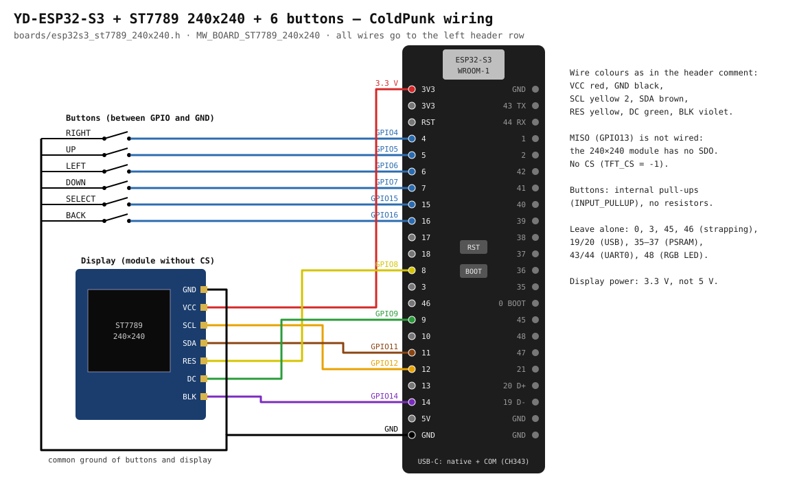

# YD-ESP32-S3 + ST7789 240×240 display + 6 buttons

A self-built variant: the VCC-GND Studio **YD-ESP32-S3** dev board (an
ESP32-S3-DevKitC-1 clone), a separate ST7789 240×240 SPI display module
(1.3" / 1.54", 7 pins, no CS) and six buttons. No touch, no card.

Header: `boards/esp32s3_st7789_240x240.h`.



## What you need

| | |
| --- | --- |
| Board | YD-ESP32-S3 with an **N8R8 or N16R8** module (8 MB PSRAM is required; the firmware does not start on N16R2 / no-PSRAM modules) |
| Display | ST7789 240×240 IPS module, pins GND VCC SCL SDA RES DC BLK |
| Buttons | 6 tactile buttons, no resistors (pull-ups are inside the chip) |
| Wires | 7 to the display, 6 to the buttons, plus a common ground |

## Selecting it

```c
// board_config.h
#define MW_BOARD_ST7789_240x240
```

## Display

| Module pin | YD board | Define | Wire colour (from the header) |
| --- | --- | --- | --- |
| GND | GND | — | black |
| VCC | **3V3** (not 5V) | — | red |
| SCL | GPIO12 | `TFT_SCK` | yellow 2 |
| SDA | GPIO11 | `TFT_MOSI` | brown |
| RES | GPIO8 | `TFT_RST` | yellow |
| DC | GPIO9 | `TFT_DC` | green |
| BLK | GPIO14 | `TFT_BL` (active high) | violet |
| — (no CS) | — | `TFT_CS -1` | — |
| — (no SDO) | leave GPIO13 unconnected | `TFT_MISO 13` | — |

A 240×240 module without a CS pin is always selected; the SPI bus carries
only the display (no card), so that is fine. The firmware reserves GPIO13 as
the bus MISO, but it does not go to the display.

## Buttons

Each button goes between its GPIO and GND (`BUTTON_ACTIVE_LOW 1`, internal
`INPUT_PULLUP`).

| Button | GPIO | Define |
| --- | --- | --- |
| Up | 5 | `BUTTON_UP` |
| Down | 7 | `BUTTON_DOWN` |
| Left | 6 | `BUTTON_LEFT` |
| Right | 4 | `BUTTON_RIGHT` |
| Select (OK) | 15 | `BUTTON_SELECT` |
| Back | 16 | `BUTTON_BACK` |

All the pins used are on the board's left header row (left on the diagram),
together with 3V3 and GND.

## Pins on the YD board to leave alone

| GPIO | Why |
| --- | --- |
| 0 | BOOT (button on the board, strapping) |
| 3, 45, 46 | strapping |
| 19, 20 | native USB — the wallet's link to the PC |
| 26–32, 35–37 | the module's flash and PSRAM |
| 43, 44 | UART0 (console, the CH343 bridge of the COM port) |
| 48 | the board's RGB LED |

## USB and flashing

The board has two USB-C connectors: the chip's **native USB** (GPIO19/20) and
**COM** through a CH343 bridge (UART0).

- The wallet's link to the PC (MoneroPunkSigner / mwlink) is native USB only.
- Either connector flashes. Through COM, esptool resets the board into the
  bootloader itself (the bridge's auto-reset circuit), no button needed.
  Through native USB, with BOOT held, as on the other boards.
- Note for "Flash only with BOOT": through an auto-reset COM port the board
  can still be flashed after those eFuses are burned — for the chip the
  bridge does what the button does. If you want that protection, keep only
  the native USB connected to the PC (or remove the auto-reset transistors).
- The COM port carries the UART0 console (log, 115200).

## Power

From USB (5 V on the board, 3.3 V regulator). Power the display from 3V3: 5 V
on the VCC of a module without its own regulator destroys it, and the
ESP32-S3 logic is 3.3 V anyway.

## Notes on `esp32s3_st7789_240x240.h`

- The comment at the top of the file is from another board (2.4" 240×320 with
  a CST816S touch and the battery on GPIO4). Here GPIO4 is the Right button
  and the battery is not measured (`BATTERY_ADC_PIN -1`). No effect on the
  build.
- `ST7789_COL_OFFSET / _ROW_OFFSET 0` are right for `DISPLAY_ROTATION 0`. With
  rotation 2 or 3 a 240×240 panel shows a shifted picture: it needs a row
  offset of 80.
- `#define MW_HMAC_EFUSE_KEY_ID 1` at the end of the file (after `#endif`) is
  not used by the firmware — it finds the device key in eFuse itself. The line
  can go.
- `DEFAULT_SEED_INPUT_MODE KEYBOARD_FULL`: on a board with buttons the scroll
  keyboard is handier — pick it in Settings, or set `SEED_INPUT_SCROLL_KB` in
  the header as the other button boards do.
